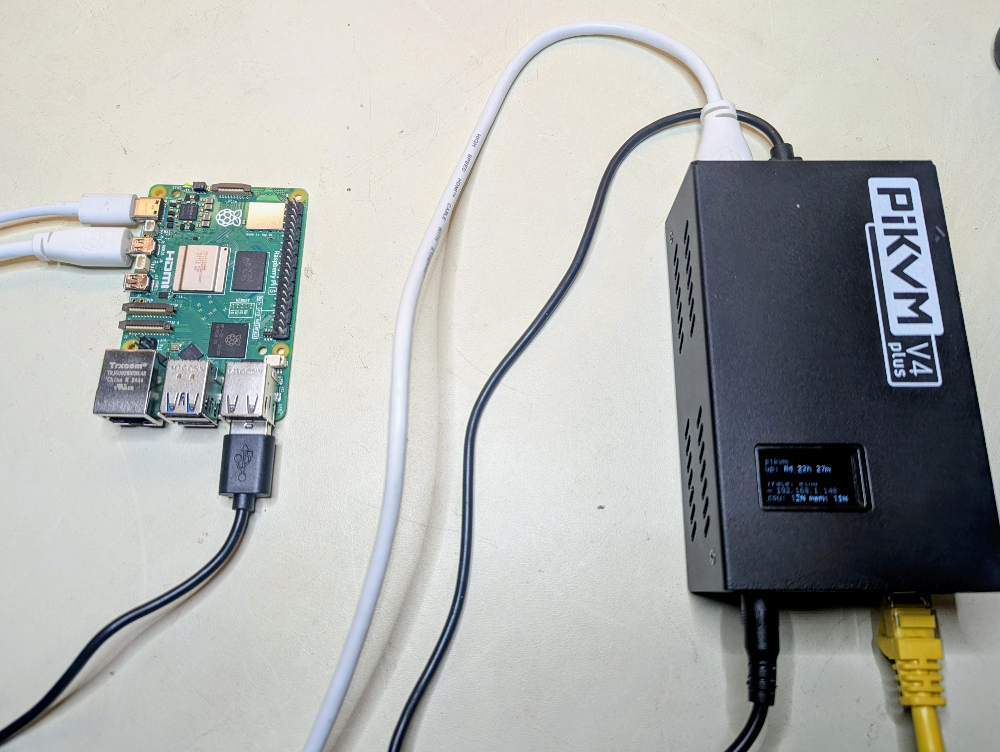

<!-- Modified 2026-10 by PLN: Node.js engines note, GPL-3.0-only licence line, and PIKVM_REQUEST_TIMEOUT_MS (GPL-3.0; see NOTICE) -->
<!-- Modified 2026-10 by PLN: MSD upload deadlines (GPL-3.0; see NOTICE) -->
<!-- Modified 2026-10 by PLN: cap MSD job at 7 days and idle at 1 hour (GPL-3.0; see NOTICE) -->
<!-- Modified 2026-10 by PLN: PIKVM_MCP_ARM_MSD and MSD status, mount, eject (GPL-3.0; see NOTICE) -->
<!-- Modified 2026-10 by PLN: mount expectImage and MSD preflight (GPL-3.0; see NOTICE) -->
<!-- Modified 2026-10 by PLN: MSD upload jobs and remove (GPL-3.0; see NOTICE) -->
<!-- Modified 2026-10 by PLN: hashing jobs, bad-image cleanup, upload try-lock (GPL-3.0; see NOTICE) -->
<!-- Modified 2026-10 by PLN: hash reads stop at the MSD job ceiling (GPL-3.0; see NOTICE) -->
<!-- Modified 2026-10 by PLN: hash timeout releases the upload slot before close (GPL-3.0; see NOTICE) -->
<!-- Modified 2026-10 by PLN: hash reads use the idle timeout (GPL-3.0; see NOTICE) -->
<!-- Modified 2026-10 by PLN: MSD progress windows (GPL-3.0; see NOTICE) -->
<!-- Modified 2026-10 by PLN: finalise window arms on request sent (GPL-3.0; see NOTICE) -->
<!-- Modified 2026-10 by PLN: upload finalise window is twice the idle timeout (GPL-3.0; see NOTICE) -->
<!-- Modified 2026-10 by PLN: stock nginx does not pre-empt the finalise window (GPL-3.0; see NOTICE) -->
<!-- Modified 2026-10 by PLN: nginx 60s bounds kvmd's finish, not the drain (GPL-3.0; see NOTICE) -->
<!-- Modified 2026-10 by PLN: the upload tool names the finalise drain limit (GPL-3.0; see NOTICE) -->
<!-- Modified 2026-10 by PLN: a slow drain can end finalise with bytes in flight (GPL-3.0; see NOTICE) -->
<!-- Modified 2026-10 by PLN: catalog budgets use a monotonic clock (GPL-3.0; see NOTICE) -->
<!-- Modified 2026-10 by PLN: a catalog read is not started with under 1 ms left (GPL-3.0; see NOTICE) -->
<!-- Modified 2026-10 by PLN: URL fetch allowlist and Tailscale opt-in (GPL-3.0; see NOTICE) -->
<!-- Modified 2026-10 by PLN: metadata embeddings, connect timeout, and fetch cleanup (GPL-3.0; see NOTICE) -->
<!-- Modified 2026-10 by PLN: deny local NAT64 and non-global wrapped IPv4 (GPL-3.0; see NOTICE) -->
<!-- Modified 2026-10 by PLN: connect timeout is independent of the idle timeout (GPL-3.0; see NOTICE) -->
<!-- Modified 2026-10 by PLN: connect timeout and DNS map to unreachable (GPL-3.0; see NOTICE) -->
<!-- Modified 2026-10 by PLN: pikvm_type delay is milliseconds (GPL-3.0; see NOTICE) -->
<!-- Modified 2026-10 by PLN: opt-in hardware suite (GPL-3.0; see NOTICE) -->
<!-- Modified 2026-10 by PLN: password and bearer secret files (GPL-3.0; see NOTICE) -->
<!-- Modified 2026-10 by PLN: empty secret vars are unset (GPL-3.0; see NOTICE) -->
<!-- Modified 2026-10 by PLN: bearer whitespace is HTTP-only (GPL-3.0; see NOTICE) -->
<!-- Modified 2026-10 by PLN: TLS verify, pin, and insecure modes (GPL-3.0; see NOTICE) -->
<!-- Modified 2026-10 by PLN: pin the leaf, expiry wording, and Node >=22.9.0 (GPL-3.0; see NOTICE) -->
<!-- Modified 2026-10 by PLN: kvmd redirects are not followed (GPL-3.0; see NOTICE) -->
<!-- Modified 2026-10 by PLN: calibration and scale are shared across HTTP sessions (GPL-3.0; see NOTICE) -->
<!-- Modified 2026-10 by PLN: screenshot defaults, crop, and optional OCR (GPL-3.0; see NOTICE) -->
<!-- Modified 2026-10 by PLN: MSD catalog readiness timeout (GPL-3.0; see NOTICE) -->
<!-- Modified 2026-10 by PLN: catalog error codes, fail-fast size, and unseen confirm (GPL-3.0; see NOTICE) -->
<!-- Modified 2026-10 by PLN: host OCR returns one JSON text block (GPL-3.0; see NOTICE) -->
<!-- Modified 2026-10 by PLN: rollbackError entries, typed eject, and catalog cleanup (GPL-3.0; see NOTICE) -->
<!-- Modified 2026-10 by PLN: a post-send job cap reports phase job_timeout (GPL-3.0; see NOTICE) -->
<!-- Modified 2026-10 by PLN: the upload response read is phase job_timeout (GPL-3.0; see NOTICE) -->
<!-- Modified 2026-10 by PLN: undici floor is 7.30.1 (GPL-3.0; see NOTICE) -->
<!-- Modified 2026-10 by PLN: allowScripts names sharp@0.35.5 (GPL-3.0; see NOTICE) -->
<!-- Modified 2026-10 by PLN: graceful shutdown (GPL-3.0; see NOTICE) -->
<!-- Modified 2026-10 by PLN: Docker quick start, client setup, CA wording, upstream badges removed (GPL-3.0; see NOTICE) -->
<!-- Modified 2026-10 by PLN: the image is published (GPL-3.0; see NOTICE) -->
<!-- Modified 2026-10 by PLN: capture start, no signal, and relative moves on an absolute mouse (GPL-3.0; see NOTICE) -->
<!-- Modified 2026-10 by PLN: situation-first errors, no-signal cause, coordinate wording, plain-text OCR (GPL-3.0; see NOTICE) -->
<!-- Modified 2026-10 by PLN: pikvm_keep_awake (GPL-3.0; see NOTICE) -->

# PiKVM MCP Server

Give AI agents hands. This MCP server connects Claude Code (or any MCP client) directly to a [PiKVM](https://pikvm.org/) device, giving AI full keyboard, mouse, and screen access to a physical machine -- no browser automation, no virtual desktops, no emulators.

Point it at real hardware. Let the AI see the screen, type commands, click buttons, and navigate GUIs on a machine it could never otherwise touch.

This is PLN's fork of [KultivatorConsulting/pikvm_mcp_server](https://github.com/KultivatorConsulting/pikvm_mcp_server), distributed under GPL-3.0-only. See [LICENSE](LICENSE) and [NOTICE](NOTICE) for the licence, the origins, and the modification log.

<p align="center">
  
  <br>
  <em>A Raspberry Pi 5 controlled via PiKVM V4 Plus -- the AI's physical interface to the real world.</em>
</p>

### Automatic Mouse Calibration

IP-KVM devices translate mouse coordinates through multiple layers — USB HID emulation, host-side input drivers, display scaling — each introducing positional error. Existing KVM products either ignore this (requiring manual correction) or offer limited auto-sync that only detects cursor acceleration in a fixed corner region.

This MCP server takes a different approach. The `pikvm_auto_calibrate` tool uses a vision-based algorithm that:

1. **Moves the cursor** a known distance across multiple randomized screen positions
2. **Diffs screenshot pairs** to isolate the cursor via connected-component analysis
3. **Computes correction factors** from detected vs commanded movement using median aggregation
4. **Self-verifies** by moving to target positions and confirming the cursor lands within 20px

The entire process runs in ~30-60 seconds with no human intervention. Noisy screens (tooltips, animations, dynamic content) are handled through multi-round sampling, ratio divergence filtering, and outlier-resistant statistics — the algorithm discards bad data and still converges on accurate factors.

This is the first IP-KVM tooling — commercial or open source — to implement fully automated mouse coordinate calibration via computer vision. It is what makes precise AI-driven mouse control over a network KVM practical.

### See it in action

The video below shows Claude Code using this MCP server to autonomously interact with a Raspberry Pi desktop: taking a screenshot to identify the OS, opening a text editor from the menu, typing text, and closing the application -- all through the PiKVM hardware interface.

[](https://youtu.be/VYE8O1gAs7s)

This next demonstration shows Claude, connected via the PiKVM MCP server, responding to a natural language prompt to auto-calibrate its mouse coordinate scaling before performing a series of precision mouse tasks on a remote machine. The session concludes with Claude autonomously drawing a house in MS Paint — a simple but effective showcase of accurate, AI-driven input control over an isolated system.

[](https://youtu.be/kNj8TJD6odo)

## Features

- **Automatic mouse calibration** — Vision-based cursor detection computes coordinate correction factors with no manual measurement. The first fully automated calibration for IP-KVM.
- **Screenshot capture** — Get current screen as JPEG image
- **Text typing** — Type text with proper special character handling via keymaps
- **Keyboard control** — Send individual keys or key combinations (e.g., Ctrl+Alt+Delete)
- **Mouse control** — Move, click, and scroll with calibrated coordinate correction

## Installation

### Docker

The container image is the default way to run the server: Node.js, tesseract, and a `/data` volume for secrets, pinned certificates, and ISO images, running as an unprivileged user. `compose.yaml` adds a read-only root filesystem with every capability dropped. The full guide, including the Tailscale sidecar, is [docs/docker.md](docs/docker.md).

Images are published to `ghcr.io/pln/pikvm_mcp_server` for amd64 and arm64.

```bash
umask 077
echo 'PIKVM_HOST=https://pikvm.example.net' > .env
openssl rand -hex 32 > bearer.txt          # the MCP client needs this token
docker compose run --rm -T --entrypoint sh pikvm-mcp -c 'umask 077; cat > /data/secrets/pikvm-mcp-bearer' < bearer.txt
printf '%s' 'the-kvmd-password' | docker compose run --rm -T --entrypoint sh pikvm-mcp -c 'umask 077; cat > /data/secrets/pikvm-password'
docker compose run --rm pikvm-mcp pin default   # compare the fingerprint with the PiKVM web UI, then type yes
docker compose up -d
claude mcp add --transport http pikvm http://127.0.0.1:8675/mcp --header "Authorization: Bearer $(cat bearer.txt)"
```

### From source

```bash
npm install
npm run build
```

Running it as a systemd service is described in [docs/systemd.md](docs/systemd.md).

`package.json` `allowScripts` is pinned to the versions in `package-lock.json`: `sharp@0.35.5` is allowed, and `esbuild@0.27.2` and `fsevents@2.3.3` are denied. sharp is used at runtime. sharp 0.35.5 publishes no install script; the pin still names that version and allows it. esbuild is only pulled in by `tsx` for `npm run dev`, and its postinstall is denied. fsevents is an optional dependency of `tsx`, installed on macOS only, and its install script is denied. A bump of any of these packages must update that pin in the same change, after the new install script is reviewed. Do not replace the map with a blanket allow. CI installs with npm 12 and `--strict-allow-scripts`, which fails the install when a dependency install script is neither allowed nor denied.

## Configuration

Copy `.env.example` to `.env` and configure:

```bash
cp .env.example .env
```

Edit `.env`:
```
PIKVM_HOST=https://<your-pikvm-ip>
PIKVM_USERNAME=admin
PIKVM_PASSWORD=your_password
PIKVM_VERIFY_SSL=false
PIKVM_TLS_MODE=insecure
PIKVM_DEFAULT_KEYMAP=en-us
PIKVM_REQUEST_TIMEOUT_MS=5000
PIKVM_SCREENSHOT_MAX_WIDTH=960
PIKVM_SCREENSHOT_MAX_HEIGHT=600
PIKVM_SCREENSHOT_QUALITY=70
PIKVM_MSD_JOB_TIMEOUT_MS=21600000
PIKVM_MSD_IDLE_TIMEOUT_MS=60000
PIKVM_MSD_READY_TIMEOUT_MS=30000
```

## Secrets

`PIKVM_PASSWORD` and `PIKVM_MCP_BEARER` are resolved in this order: the direct environment variable, then `<NAME>_FILE`, then `$CREDENTIALS_DIRECTORY/<credential>` when `CREDENTIALS_DIRECTORY` is set. The credential names are `pikvm-password` and `pikvm-mcp-bearer`. A registry device does not use those two variables. Its password is `passwordFile` or `passwordCredential` in the registry JSON.

| Variable | Role |
| --- | --- |
| `PIKVM_PASSWORD` | kvmd password. A non-empty value wins over the file and the credential. An empty value is unset. |
| `PIKVM_PASSWORD_FILE` | Path of a regular file holding the password. An empty value is unset. |
| `PIKVM_MCP_BEARER` | HTTP bearer. A non-empty value wins over the file and the credential. An empty value is unset. Required only when `PIKVM_MCP_PORT` is set. |
| `PIKVM_MCP_BEARER_FILE` | Path of a regular file holding the bearer. An empty value is unset. |
| `CREDENTIALS_DIRECTORY` | systemd `LoadCredential` directory. Consulted only when it is set, and only for a secret that was not set above. A missing credential file means that secret is unset. A direct child of this directory, when the directory is under `/run/credentials/<name>/`, the file is not a symlink, and the opened inode is still that path, does not warn about group bits. |

A direct value is used verbatim, including a trailing newline. Only file bytes lose exactly one trailing newline (`\n` or `\r\n`) and a leading UTF-8 BOM. Other whitespace, including a trailing space or a second newline, stays. Empty file content is a startup error. A NUL byte in a file is an error that names the variable and the path. An empty direct value and an empty `*_FILE` are unset and fall through. Symlinks are followed. The file is opened non-blocking and the opened target must be a regular file: a directory, FIFO, socket, or device is rejected, and a FIFO open does not wait. Other bits (`o+rwx`) are warned on stderr, with the variable name, the path, and the mode, never the value. Group bits are warned the same way, except when every one of these holds: `CREDENTIALS_DIRECTORY` is set, `realpath` of the file is a direct child of `realpath` of that directory, that directory is under `/run/credentials/<name>/` (not `/run/credentials` itself), the opened path is not a symlink, and `fstat` of the opened file has the same device and inode as `stat` of that real path. The credentials root is `/run/credentials` (or the test stand-in). `CREDENTIALS_DIRECTORY` does not choose that root. systemd `LoadCredential` files are often mode `0440` because of an ACL mask, and that group bit is not warned. The same exception applies when `PIKVM_PASSWORD_FILE`, `PIKVM_MCP_BEARER_FILE`, or a registry `passwordFile` points at such a file. The reader does not change the mode or the owner, and it does not copy the file. The mode check is skipped on Windows. A file larger than 64 KiB is rejected before the body is read. A missing or unreadable `*_FILE` is a startup error that names the variable and the path. If the direct variable and `*_FILE` are both non-empty, the direct variable wins and one stderr line says the file variable was ignored. In HTTP mode, a bearer with leading or trailing whitespace is rejected at startup. stdio does not use the bearer, so the same value still starts. The error names `PIKVM_MCP_BEARER` and not the value. None of these messages include the secret. A registry `passwordFile` uses this same file reader. `passwordCredential` is one path segment under `CREDENTIALS_DIRECTORY`.

A systemd drop-in that loads both credentials is in [docs/systemd.md](docs/systemd.md). The container image fills `PIKVM_PASSWORD_FILE` and `PIKVM_MCP_BEARER_FILE` from `/data/secrets/` instead ([docs/docker.md](docs/docker.md)).

`PIKVM_REQUEST_TIMEOUT_MS` is the abort deadline, in milliseconds, for one ordinary kvmd call. It must be a string of digits from 1 to 600000 (default 5000). `5000abc`, `1e3`, ` 5000 `, `5.5`, and `0` use the default. A value above 600000 is clamped to 600000. An idempotent GET that fails with a network error, a timeout, HTTP 502, or HTTP 503 is tried up to 3 times (backoff 250 ms, then 500 ms, plus a little jitter). POST is not retried. HTTP 500 and 504 are not retried. `GET /streamer/snapshot` retries HTTP 503 once after a 1500 ms grace period, for the ustreamer idle-stop race. That extra try does not use up one of the three attempts, so a snapshot can make at most 4 calls.

kvmd runs its video capture only while a web viewer, or another stream-enabled WebSocket client, is connected. When capture is stopped, a screenshot, an OCR capture or a resolution read opens one authenticated `/api/ws?stream=1` session for that device, waits up to 10 s for a video signal, and keeps the session for 60 s after the last capture. kvmd stops capture about 10 s after that. No input is sent to start it. Capture that runs without a video signal is `PIKVM_NO_SIGNAL`: the computer may be off or asleep, or its display blanked, and a key press such as ShiftLeft wakes a blanked display. The resolution read is `PIKVM_NO_SIGNAL` too, so an absolute mouse move is not scaled to ustreamer's 640x480 placeholder. A session that kvmd refuses, or capture that does not start within 10 s, is `PIKVM_CAPTURE_START_FAILED`.

kvmd drops queued input and releases held keys and mouse buttons whenever any WebSocket session opens or closes. So this server opens and closes its session only when none of its own HID calls is in flight, its queued reports have had time to drain (about 10 ms per character of prints with no delay, added up across prints, plus 250 ms), and no key or button it pressed is still held. Starting capture with input held is refused as `PIKVM_CAPTURE_HELD_INPUT`, and an idle session stays open until the input is released. A web viewer that opens or closes has the same effect on input; that is kvmd's behaviour.

`PIKVM_NO_SIGNAL` carries a `cause`, read from kvmd's USB HID state. `display_asleep`: the USB keyboard or mouse is online, so the computer is attached and only its display is dark; a key press wakes it. `usb_offline`: both are offline, so the computer is off, suspended or unplugged; a key press can only wake a suspended computer that allows USB wake-up. `unknown`: the HID state could not be read.

Errors that this server raises itself (`PIKVM_NO_SIGNAL`, `PIKVM_CAPTURE_START_FAILED`, `PIKVM_CAPTURE_HELD_INPUT`, `PIKVM_MOUSE_ABSOLUTE`) lead with the situation: `Error [TYPE]: message`. Errors from kvmd keep `Error [TYPE] METHOD /api/path (HTTP status): message`. When there is an obvious next step, a `Next: <tool> <arguments>` line follows; with a device registry, the arguments name the device. The last line is always the JSON details: `status`, `type`, `message`, `endpoint`, and `cause` and `next` when set. The same object is `structuredContent.error`.

`PIKVM_MSD_JOB_TIMEOUT_MS` (default 21600000, six hours) is only a last-resort safety cap for an MSD image upload or URL download. `msdWrite` and `msdWriteRemote` do not use `PIKVM_REQUEST_TIMEOUT_MS`, because kvmd does not answer an upload until it has read the body. Local hashing before the upload POST uses that same length as its own cap. The hash timer starts when hashing starts and is cleared when hashing finishes, so a finished hash does not shorten the upload POST, and the POST still gets a fresh cap of the same length. A hash read that is still going when that ceiling ends stops. The upload slot is released without waiting for the file to close, and the job fails with `PIKVM_MSD_HASH_TIMEOUT` (`hash timeout after <ms>ms`). The descriptor is closed from that read's callback, or immediately when no hash read is in flight. A close error on that path is logged and does not replace the job error. The upload POST is not sent. `PIKVM_MSD_IDLE_TIMEOUT_MS` (default 60000) is the progress bound for every phase of those calls: each local hash read, the upload body, the upload finalise window (twice this value, 120 seconds by default, from undici's onRequestSent when the body has been handed to the socket until response headers), the `write_remote` wait for response headers (the connect timeout plus this idle value, measured from when the request is sent), and each gap in the `write_remote` NDJSON stream. The final progress line is one more chunk of that stream, so the per-chunk idle bound already covers it. A phase that keeps making progress is not stopped by this timer, so a slow steady hash or a steady stream keeps going until the job cap. A hash read that does not return within the idle limit fails the job with `PIKVM_MSD_HASH_IDLE_TIMEOUT`. The limit includes time the read spends queued on the threadpool. A read that returns 0 bytes ends the hash and does not trip the bound. The message names the file, the limit in milliseconds, and `PIKVM_MSD_IDLE_TIMEOUT_MS`. The upload slot is released without waiting for the file to close, the descriptor is closed from that read's callback or immediately when no hash read is in flight, and the upload POST is not sent. Lowering `PIKVM_MSD_IDLE_TIMEOUT_MS` because the network is quiet can fail a hash on a slow or spun-down disk, because the same value bounds each local disk read. An upload finalise timeout and a `write_remote` header timeout are `PIKVM_MSD_STATE_UNKNOWN`, the same code a stalled upload body already uses, so the slot is released the same way and the image is not removed. The finalise message says the timeout happened while waiting for kvmd to finish the write and names 2× `PIKVM_MSD_IDLE_TIMEOUT_MS`. The header message names the connect timeout plus `PIKVM_MSD_IDLE_TIMEOUT_MS`. Those errors carry `phase` `finalise` or `write_remote_headers`. The code stays `PIKVM_MSD_STATE_UNKNOWN`. When `PIKVM_MSD_JOB_TIMEOUT_MS` ends the transfer after the request has been sent, on the upload body, the upload finalise window, the upload response read, the `write_remote` header window, or the `write_remote` stream, the error stays `PIKVM_MSD_STATE_UNKNOWN` and carries `phase` `job_timeout`. The message is `job timeout after <ms>ms (PIKVM_MSD_JOB_TIMEOUT_MS); image may be partial or complete; re-read /api/msd; do not resend`. The slot is released the same way and the image is not removed. An idle abort keeps the generic message and no phase. A finalise abort keeps `phase` `finalise`. A header-window abort keeps `phase` `write_remote_headers`. Only the job cap uses `job_timeout`. A hash that is still running when the cap ends stays `PIKVM_MSD_HASH_TIMEOUT` (`hash timeout after <ms>ms`). The body timer re-arms when undici hands a chunk to the socket (`onBodySent`), not when the local source yields. `Readable.from` uses `highWaterMark` 1 so the source stays within one chunk of that handoff. The finalise window starts at onRequestSent. We cannot see when kvmd has actually read the bytes, only when they were handed to the socket, so the OS send buffer and the peer's receive window can still be draining after the body is sent. The 2× window allows for that drain. The client can only see bytes handed to the socket, not bytes that kvmd has read. If the OS send buffer and the peer receive window take longer than 2× `PIKVM_MSD_IDLE_TIMEOUT_MS` to drain (a very slow link with a few MiB buffered), the upload ends with `PIKVM_MSD_STATE_UNKNOWN`, phase `finalise`, while bytes may still be in flight. The image may be partial or complete, so re-read `/api/msd` and do not resend. Raising `PIKVM_MSD_IDLE_TIMEOUT_MS` widens the window. An upload's undici `headersTimeout` is `PIKVM_MSD_JOB_TIMEOUT_MS`, defence in depth beside the job cap: undici refreshes that timer only on socket backpressure and again when the body has been handed off, so the idle value would abort a slow steady upload. `headersTimeout` and `bodyTimeout` are FastTimers at every delay, including 1000ms or less. undici's `timers.setTimeout` uses a native timer at 1000ms or less; the header and body timers do not. The progress timers are native, and on an upload the headers timer is the job cap, so the shorter finalise timer is the one that fires. A value that is not a string of digits, or 0, uses the default. The job cap is clamped to 7 days (604800000) and the idle gap to 1 hour (3600000). They are not clamped to the ten-minute ordinary-call cap. `write_remote` `timeout=` is a separate connect timeout (`PIKVM_MSD_URL_CONNECT_TIMEOUT_SEC`, default 30 seconds). It is not this job cap. The header window is that connect timeout plus `PIKVM_MSD_IDLE_TIMEOUT_MS`. Per kvmd's shipped nginx config, `/api/msd/write` does not set `proxy_read_timeout` or `proxy_send_timeout`, so nginx's 60s defaults apply. nginx's 60s `proxy_read_timeout` starts only after the whole body has gone upstream, so it bounds kvmd's own finish (a 504, reported as `PIKVM_MSD_STATE_UNKNOWN`), not the drain, which can use the full 120s. `/api/msd/write_remote` sets `proxy_read_timeout 7d`. `PIKVM_MSD_READY_TIMEOUT_MS` (default 30000) is how long a job that kvmd already accepted waits for that exact image to be present, complete, and the same size in the catalog. Polls start at 250 ms and rise to 2 seconds. The budget is monotonic elapsed time and includes each `GET /api/msd`, so a slow read is aborted when the deadline is reached. A read is not started when less than 1 ms remains. A step of the realtime clock does not shorten or extend it. Removal confirmation uses the same clock. The upload POST and the remote write are not repeated. A complete row with the wrong size fails at once. An incomplete row keeps polling until the deadline. The value is digits only, and a value above 600000 is clamped. The job state during that wait is `awaiting_catalog`. The per-device MSD lock stays held until the wait ends, so a mount cannot select the image first. Cleanup of an image that never appeared in the catalog uses `MSD_UNSEEN_CONFIRM_MS` (750 ms, three polls, or the readiness budget when that is shorter). If that image appears, confirmation continues for the readiness budget.

POST `/hid/*` uses its own ceiling, because kvmd answers only after the input has been applied and a client abort does not cancel that work. `/hid/print` waits `5s + 1.5 × (4·min(length,1024) + 2) × perEventSec + 5s`, and at least 10s. `perEventSec` is the `pikvm_type` `delay` in milliseconds divided by 1000 (50 is sent as 0.05, 200 as 0.2). kvmd reads that query value as seconds. When `delay` is omitted, slow uses 0.02s and otherwise the per-event wait is 0. When that ceiling expires the tool returns `PIKVM_HID_STATE_UNKNOWN` (`input may still be applying; do not resend`) and the call is not retried. A print whose estimate is above 50s is refused before any kvmd call, with a message to shorten the text or lower the delay. With `slow` and no `delay`, that line is 333 characters: 332 still fits under 50s, and 333 does not. kvmd itself accepts up to 1024 characters. PiKVM's nginx likely applies the default 60s `proxy_read_timeout` on `/api/`; that has not been confirmed on hardware. Every other HID POST (key, shortcut, mouse, wheel, reset) uses a fixed 30s ceiling and the same unknown-state error. A connection reset or other socket error after a HID POST was sent is also `PIKVM_HID_STATE_UNKNOWN` and is not retried. A failure before the request is sent, such as connection refused, a connect timeout, or DNS `ENOTFOUND` / `EAI_AGAIN`, stays `PIKVM_UNREACHABLE` and is not retried either. A GET retries those the same way it retries connection refused. An HTTP redirect is `PIKVM_UNEXPECTED_REDIRECT`. GET, POST, HID, and uploads do not follow it, so `X-KVMD-Passwd` is not sent to the `Location` target. The error names the status and the `Location` origin, without the path, the query, or any userinfo.

## TLS

kvmd ships a self-signed certificate. Three modes select how this process checks it. With no registry the device name is `default`. A registry device sets its own `tls.mode`.

| Variable | Role |
| --- | --- |
| `PIKVM_TLS_MODE` | `verify`, `pin`, or `insecure`. Unset follows `PIKVM_VERIFY_SSL` (see below). |
| `PIKVM_TLS_CERT_FILE` | PEM file for `pin`. Required in that mode. A regular file, at most 64 KiB. Opened the same non-blocking way as a secret file. It is not a secret: a loose mode is not warned. |
| `PIKVM_VERIFY_SSL` | Legacy switch. Exactly `true` means `verify`. Any other value, including unset, means `insecure`. Ignored when `PIKVM_TLS_MODE` is set, with one stderr line when the two disagree. |

`verify` checks the certificate against Node's bundled CA roots, not the host's CA store, and checks the hostname. To trust a private CA, set `NODE_EXTRA_CA_CERTS` to its PEM file before the process starts (the container image does this for `/data/tls/ca.pem`). A stock self-signed certificate fails with `PIKVM_TLS_VERIFY_FAILED`. `pin` sends the pinned PEM as the only CA, keeps certificate checking on, and compares the leaf SPKI sha256. The hostname is not the identity, so an IP or a name that is not on the certificate still matches when the key matches. A CA-signed leaf is trusted on its own (`allowPartialTrustChain`), which is how a Tailscale or Let's Encrypt certificate works after `pin default`. Pin the leaf only. Pinning a CA or an intermediate fails with `PIKVM_TLS_PIN_MISMATCH`, because that key is not the leaf key. `insecure` turns certificate checks off.

`insecure` is the current default: if `PIKVM_TLS_MODE` is unset and `PIKVM_VERIFY_SSL` is not exactly `true`, the process uses `insecure` and writes one stderr line naming that mode and `pikvm-mcp-server pin default`. That keeps existing self-signed setups working. Switching the default to `pin` or `verify` waits for a later major release. An explicit `PIKVM_TLS_MODE=insecure` logs the same kind of warning. A pin failure or a verify failure is terminal. It is not retried, it is not reported as `PIKVM_UNREACHABLE`, and it never falls back to `insecure`.

Pin a host over Tailscale by reading the certificate once, out of band, and then checking it on every connection:

```bash
export PIKVM_HOST=https://pikvm.example.ts.net
export PIKVM_TLS_CERT_FILE=/etc/pikvm-mcp/default.pem
pikvm-mcp-server pin default
export PIKVM_TLS_MODE=pin
```

`pin default` connects once, with verification disabled only for that handshake. It sends no request and no password. It prints the subject, issuer, validity, SHA-256 certificate fingerprint, and SPKI sha256. On a terminal it writes the file only after you type `yes`. Without a terminal it writes nothing unless you pass `--yes`. `--yes` is for a scripted re-pin after the new certificate was verified out of band. Replacing an existing file prints the old SPKI and the new SPKI first. A file that is already there but is corrupt or not a certificate is shown as `old SPKI sha256: unreadable`, and the command still asks before it writes. The write is a temp file in the same directory, then a rename, mode `0644`. The rename replaces a symlink at `--out` and does not write through it. On POSIX the directory is fsynced after the rename, best-effort. The command writes the leaf only, and it does not run by itself. A pin failure does not run it. An `https://[::1]/` host is connected as `::1` with no SNI name.

An optional alternative is `verify` with a Tailscale certificate. On the PiKVM, `tailscale cert pikvm.example.ts.net` creates a certificate for that MagicDNS name. Those certificates come from Let's Encrypt, which Node already trusts. Set `PIKVM_HOST=https://pikvm.example.ts.net` and `PIKVM_TLS_MODE=verify`, and leave `PIKVM_TLS_CERT_FILE` unset. That is a choice, not the default, and it still needs the name on the certificate to match the host.

## Device registry

With `PIKVM_DEVICES_FILE` and `PIKVM_DEVICES` both unset, the server is the single legacy device `default`: `PIKVM_HOST`, `PIKVM_USERNAME`, `PIKVM_PASSWORD` (or `PIKVM_PASSWORD_FILE` or `CREDENTIALS_DIRECTORY/pikvm-password`), `PIKVM_TLS_MODE`, `PIKVM_VERIFY_SSL`, and the arm flags. Nothing in that setup has to change.

Set one of the registry variables to name more than one device. Setting both is a startup error. `PIKVM_DEVICES_FILE` is a JSON file, opened the same non-blocking way as a secret file and capped at 64 KiB. It is not a secret, so a loose mode is not warned. `PIKVM_DEVICES` is the same JSON inline, also capped at 64 KiB. An empty value is unset.

If `PIKVM_HOST` is also set, the registry is used and one stderr line says `PIKVM_HOST` was ignored. The legacy host, password, and TLS mode are not merged into the registry.

`default` must name a device. If it is omitted and there is exactly one device, that device is the default. With several devices, `default` is required. A device name matches `/^[a-z0-9][a-z0-9_-]{0,31}$/`. Unknown fields are a startup error that names the device and the field. A `password` field is rejected; use `passwordFile` or `passwordCredential`. Exactly one of those is required. `passwordFile` is read like any other secret file, including the mode warning. `passwordCredential` is a single path segment in `$CREDENTIALS_DIRECTORY`.

A host is normalised to an http(s) origin. A path, query, or fragment is dropped. Userinfo is an error. There is no IP-range restriction, so a Tailscale `100.64.0.0/10` address or a MagicDNS name is a normal host. `tls.mode` is `verify`, `pin`, or `insecure`. If it is omitted, the device uses `insecure` and stderr names that device and `pikvm-mcp-server pin <device>`. `pin` requires `tls.certFile` and an https origin. `verify` requires https. `PIKVM_TLS_MODE` does not apply to registry devices.

`armHid` and `armMsd` on a device can only narrow the process ceiling. In stdio the ceiling is armed. In HTTP the ceiling is `PIKVM_MCP_ARM_HID` and `PIKVM_MCP_ARM_MSD` (default disarmed). An omitted device flag leaves the ceiling. `true` cannot arm a device the ceiling has disarmed. `msdLocalDir` overrides `PIKVM_MSD_LOCAL_DIR` for that device. `hwTest` must be true before the hardware suite will use the device. `screenshot` is optional and may set `maxWidth`, `maxHeight`, and `quality`. An omitted field uses `PIKVM_SCREENSHOT_MAX_WIDTH`, `PIKVM_SCREENSHOT_MAX_HEIGHT`, or `PIKVM_SCREENSHOT_QUALITY`. `ocr` is optional and may set `engine` (`off` or `kvmd`), `langs`, and `minConf`. It can only narrow the process. `engine: "host"` is rejected because the binary is process-wide. Unknown keys are a startup error.

Each device has its own client, busy lock, MSD job lock, calibration, and arm state. Calibration and the screenshot scale are stored on the device and shared by every HTTP session that uses that device. Per-session state is deferred. Every `pikvm_*` tool except `pikvm_devices` takes an optional `device` argument. Omitted means the registry default. An unknown name is an error that lists the known names and does not open a connection. While a registry is active, tool output names the device that was used. `pikvm_devices` lists names, origins, TLS mode, and arm state. It does not return passwords or secret file paths.

Job ids are random 16-byte hex strings. A job is visible only to the device that created it. Asking for it on another device is the same `unknown job` result as an id that does not exist.

Two Tailscale devices, one pinned and one checked with a Tailscale certificate:

```json
{
  "default": "lab1",
  "devices": {
    "lab1": {
      "host": "https://100.64.0.8",
      "username": "admin",
      "passwordCredential": "pikvm-lab1",
      "tls": { "mode": "pin", "certFile": "/etc/pikvm-mcp/lab1.pem" },
      "armHid": false,
      "armMsd": true,
      "msdLocalDir": "/srv/iso",
      "hwTest": false
    },
    "lab2": {
      "host": "https://pikvm.example.ts.net",
      "username": "admin",
      "passwordCredential": "pikvm-lab2",
      "tls": { "mode": "verify" },
      "armHid": false,
      "armMsd": false,
      "hwTest": true
    }
  }
}
```

`lab2` is `verify` against the MagicDNS name on a Tailscale certificate, which Node trusts without extra setup. `lab1` is pinned. Create or replace the pin with `pikvm-mcp-server pin lab1`, which connects to `lab1`'s host and writes `tls.certFile` unless `--out` is set. The first pin can run before that file exists. The command still sends no password.

`passwordCredential` names a systemd credential; [docs/systemd.md](docs/systemd.md) has the matching drop-in. In the container image use `passwordFile` with a path under `/data/secrets/` instead, and absolute `/data/...` paths for `tls.certFile` and `msdLocalDir`. Do not also set `PIKVM_HOST` or `PIKVM_PASSWORD` for these devices.

| Variable | Default | Meaning |
| --- | --- | --- |
| `PIKVM_DEVICES_FILE` | unset | Path of the registry JSON. A regular file, at most 64 KiB. Not a secret. |
| `PIKVM_DEVICES` | unset | The same JSON inline. Ignored when empty. An error when the file is also set. |
| `PIKVM_HW_TEST_DEVICE` | unset | Hardware suite device. `default` in legacy mode. In registry mode the device must set `hwTest` true. |

`pikvm-mcp-server pin <device>` accepts a registry name. With no registry, a name other than `default` is still an error.

kvmd regenerates its self-signed certificate when the PiKVM is reinstalled. The next call then fails with `PIKVM_TLS_PIN_MISMATCH`. The message names device `default`, the expected SPKI sha256, and the presented SPKI sha256. The process does not retry the call, does not try `insecure`, and does not rewrite the pin file. A chain failure whose OpenSSL code is outside the usual set, including an invalid CA or a path-length failure, is still `PIKVM_TLS_VERIFY_FAILED` or `PIKVM_TLS_PIN_MISMATCH`. It is not `PIKVM_UNREACHABLE` and it is not retried.

An expired pinned certificate stays rejected with `PIKVM_TLS_VERIFY_FAILED`. The message says the certificate has expired. Regenerate or renew the kvmd certificate, then pin the new certificate. Pinning the expired certificate again does not make it valid.

1. Read both fingerprints in the error. They are public; the password is not logged.
2. Compare the presented fingerprint out of band, on a channel you already trust.
3. Run `pikvm-mcp-server pin default`. Confirm the old and new SPKI values and type `yes`, or pass `--yes` only after that out-of-band check.
4. Restart the server so it reads the new `PIKVM_TLS_CERT_FILE`.

## HTTP Mode (remote / gateway deployments)

By default the server speaks stdio (spawned directly by an MCP client on the
same machine). Set `PIKVM_MCP_PORT` to serve MCP over the
[Streamable HTTP transport](https://modelcontextprotocol.io) instead — the
mode used when a gateway exposes the device to off-box agents:

```bash
PIKVM_MCP_PORT=8675
PIKVM_MCP_HOST=127.0.0.1
PIKVM_MCP_BEARER=<openssl rand -hex 32>
PIKVM_MCP_ARM_HID=0
PIKVM_MCP_ARM_MSD=0
PIKVM_MCP_NO_DOTENV=0
```

- **`PIKVM_MCP_PORT`** — enables HTTP mode. The endpoint is `/mcp` (MCP
  Streamable HTTP; initialize first, then send `mcp-session-id` on every
  request, `DELETE /mcp` to end the session; idle sessions are reaped after
  24h with an hourly sweep). `GET /healthz` returns `200 ok`
  unauthenticated for supervision scripts.
- **`PIKVM_MCP_HOST`** — bind address, default `127.0.0.1`. Set it to a
  specific interface address (e.g. the docker bridge gateway IP `172.17.0.1`)
  if a containerized reverse proxy needs to reach the instance from outside
  host loopback. On a host, avoid wildcard binds (`0.0.0.0`) — bind only the
  interface the proxy actually uses. The container image binds `0.0.0.0`
  inside its own network namespace, and `compose.yaml` publishes the port on
  `127.0.0.1` only.
- **`PIKVM_MCP_BEARER`** — required token for every `/mcp` request
  (`Authorization: Bearer <token>`), on POST, GET, and DELETE alike. HTTP
  mode **refuses to start** without it. The refusal names `PIKVM_MCP_BEARER`,
  `PIKVM_MCP_BEARER_FILE`, and `CREDENTIALS_DIRECTORY/pikvm-mcp-bearer`.
  An empty `PIKVM_MCP_BEARER` does not stop stdio mode. Leading or trailing
  whitespace on the configured bearer is rejected at startup, by name only.
  Missing or incorrect tokens get `401` +
  `WWW-Authenticate: Bearer`. Comparison is constant-time (sha256 digests +
  `crypto.timingSafeEqual`), and the token is never written to logs.
  `PIKVM_MCP_BEARER_FILE` or `CREDENTIALS_DIRECTORY/pikvm-mcp-bearer` can
  supply it instead. See Secrets above.
- **`PIKVM_MCP_ARM_HID`** — the HID arm-gate. HTTP mode defaults to
  **disarmed**: every HID-mutating tool (`pikvm_type`, `pikvm_key`,
  `pikvm_shortcut`, `pikvm_mouse_move`, `pikvm_mouse_click`,
  `pikvm_mouse_scroll`, `pikvm_calibrate`, `pikvm_auto_calibrate`) returns a
  typed error naming this variable and no HID events reach the device.
  Read-only tools (`pikvm_screenshot`, `pikvm_get_resolution`,
  `pikvm_get/set/clear_calibration`) stay available. Set `1` to arm. stdio
  mode is never gated — local callers gate on their own side.
- **`PIKVM_MCP_ARM_MSD`** — the MSD arm-gate, separate from HID. HTTP mode
  defaults to **disarmed**: every `pikvm_msd_*` tool except the read-only
  allowlist (`pikvm_msd_status`, `pikvm_msd_job`) returns a typed error naming
  this variable and no mass-storage change reaches the device.
  `PIKVM_MCP_ARM_HID=1` does not arm them. Set `1` to arm. stdio mode is never gated.
- **`PIKVM_MSD_LOCAL_DIR`** — directory `pikvm_msd_upload` may read, by bare
  file name only. Unset hides that tool. The container image defaults it to
  `/data/images`.
- **`PIKVM_MSD_MAX_BYTES`** — per-transfer cap. Default 16 GiB.
- **`PIKVM_MSD_URL_ALLOWLIST`** — comma-separated entries. An https entry is
  `https://host[:port]/path-prefix` (`https://images.example/iso` matches that
  path and its children, not `isotope`). A Tailscale opt-in is a CIDR inside
  `100.64.0.0/10` or `fd7a:115c:a1e0::/48`, for example `100.64.0.0/10` or
  `100.101.102.103/32`. A CIDR does not match URLs by itself; the https entry
  still has to match, and every resolved address in those ranges must fall in
  one of the CIDRs. A CIDR whose first or last address is always denied,
  such as `100.100.100.100/32`, is rejected when the config loads, and
  the error names that entry. No https entry hides `pikvm_msd_fetch_url`.
- **`PIKVM_MSD_URL_ALLOW_PRIVATE`** — `1` allows an allowlisted host to resolve
  to loopback, unspecified (`0.0.0.0/8`, `::`), RFC1918, other ULA (`fc00::/7`
  outside the Tailscale range), multicast, or broadcast. It does not allow
  Tailscale/CGNAT (`100.64.0.0/10`, `fd7a:115c:a1e0::/48`); those need a CIDR
  opt-in. Link-local and metadata stay denied even when this is `1` and even
  when the host is allowlisted: `169.254.0.0/16`, `fe80::/10`, the AWS IPv6
  metadata address `fd00:ec2::254`, Tailscale's own service addresses
  `100.100.100.100`, `100.100.100.200`, and `fd7a:115c:a1e0::53`, the whole
  local-use NAT64 prefix `64:ff9b:1::/48`, and the IPv4-mapped forms of
  every denied range. `64:ff9b:1::/48` is denied outright and is not
  decoded. IPv4 embedded in `::/96` (other than `::` and `::1`),
  `64:ff9b::/96`, or `2002::/16` is allowed only when that IPv4 is a
  global public address. `ALLOW_PRIVATE` and a Tailscale CIDR do not
  cover a wrapped form. An IPv4-mapped address (`::ffff:`) is the socket
  form of a plain IPv4 address and follows the plain rules. Reserved and documentation
  ranges stay denied too (`240.0.0.0/4`, `198.18.0.0/15`, `192.0.0.0/24`,
  `192.0.2.0/24`, `198.51.100.0/24`, `203.0.113.0/24`, `fec0::/10`,
  `2001:db8::/32`). A literal allowlist host in an always-denied range is
  rejected when the config loads. That error names the entry with
  userinfo and the query removed. Default `0`.
- **`PIKVM_MSD_URL_CONNECT_TIMEOUT_SEC`** — connect timeout sent to kvmd as
  `write_remote` `timeout=` (aiohttp `sock_connect`). Digits only, default
  30, clamped to 120. A value that is not a string of digits uses the
  default and logs a warning. `0` and an empty value use the default
  quietly. This timer is not clamped to `PIKVM_MSD_IDLE_TIMEOUT_MS`
  (default 60 seconds). They measure different things: this is how long
  aiohttp may spend opening the connection. The idle timeout is the
  progress bound for each local hash read, the upload body, upload
  finalise (twice the idle value), `write_remote` response headers (this
  connect timeout plus the idle timeout), and the `write_remote` stream.
  The finalise window is longer because the OS send buffer and the peer's
  receive window can still be draining after the body is handed to the
  socket. We cannot see when kvmd has actually read the bytes, only when
  they were handed to the socket. nginx's 60s `proxy_read_timeout` starts
  only after the whole body has gone upstream, so it bounds kvmd's own
  finish (a 504, reported as `PIKVM_MSD_STATE_UNKNOWN`), not the drain,
  which can use the full 120s. A hash read that does not return
  within the limit fails, threadpool queueing included.
  A read that returns 0 bytes ends the hash. The bound is not a cap on
  a phase that keeps making progress. `PIKVM_MSD_JOB_TIMEOUT_MS` is only
  the last-resort cap. After the request has been sent that cap is
  `phase` `job_timeout`. An idle abort has no phase. Finalise stays
  `finalise` and the header window stays `write_remote_headers`.
  The catalog wait uses `PIKVM_MSD_READY_TIMEOUT_MS`.
  Lowering the idle timeout for the network can fail a hash on a slow
  or spun-down disk.
- **Redirect and DNS.** A trailing dot on a hostname is removed before
  DNS and before the URL is sent, so both use the same host. The MCP
  host's DNS answers can differ from the PiKVM's. kvmd (aiohttp) follows
  up to 10 redirects, including an https to
  http downgrade, and resolves DNS itself. This server does not send a
  `redirect: 'manual'` HEAD before the download. Allowlist only
  operator-controlled hosts that do not redirect. A name that changes
  address after the check can still be fetched by kvmd. kvmd logs the full
  URL, including userinfo and the query string, in the PiKVM journal. Error
  text from this server drops both.
- **`PIKVM_MCP_NO_DOTENV`** — set `1` to skip `.env` loading entirely (for
  systemd/gateway units that export env directly; a stray `.env` on disk must
  not win). Only read from the real process environment, so a `.env` cannot
  enable it for itself. Even without it, explicitly-set process env always
  beats `.env` values — dotenv uses `override: false`, so `.env` only fills
  variables the caller did not set.

Quick smoke test:

```bash
# 401 without a token
curl -i -X POST http://localhost:8675/mcp -H 'Content-Type: application/json' \
  -H 'Accept: application/json, text/event-stream' \
  -d '{"jsonrpc":"2.0","id":1,"method":"initialize","params":{}}'

# 200 initialize with the token
curl -i -X POST http://localhost:8675/mcp \
  -H 'Authorization: Bearer <token>' -H 'Content-Type: application/json' \
  -H 'Accept: application/json, text/event-stream' \
  -d '{"jsonrpc":"2.0","id":1,"method":"initialize","params":{"protocolVersion":"2025-06-18","capabilities":{},"clientInfo":{"name":"curl","version":"1.0"}}}'
```

### Security notes

- Bearer auth is mandatory in HTTP mode by design: the server can move real
  hardware, and an unauthenticated network listener would let anyone type on
  the machine it is connected to.
- Keep the HTTP server behind a trusted network (WireGuard/VPN); bearer-only
  transport is not a substitute for network isolation.
- Run with `PIKVM_MCP_ARM_HID=0` and `PIKVM_MCP_ARM_MSD=0` unless the
  deployment is explicitly supposed to drive HID or change virtual media;
  arming is a per-deployment, explicit decision.
- Bind defaults to `127.0.0.1`; widen it only when a local proxy/gateway
  actually needs the network, and front with a reverse proxy for TLS
  termination or origin/host filtering. In Docker, keep the published port
  on `127.0.0.1` ([docs/docker.md](docs/docker.md), Exposure).
- No SSE streams: POSTs always return a single JSON body and the standalone
  GET SSE stream answers 405. Long-lived SSE connections are killed by
  Cloudflare's edge (and similar proxies), so keeping every MCP exchange a
  plain HTTP round-trip is the CF-safe configuration.
- `/healthz` is intentionally unauthenticated and will be reachable through
  any proxy in front of the server. It returns only the constant body `ok`
  on GET — no state, version, or device information — so public exposure is
  limited to a liveness oracle. Gate it at the proxy if you don't want even
  that.

## Shutdown

SIGTERM and SIGINT start one shutdown in both stdio and HTTP mode. The handlers are registered before the startup checks, so a signal during startup exits 0. A finished shutdown exits 0. Eight seconds after the first signal, the process exits 1 if shutdown has not finished. That timer does not keep the process alive on its own. A second SIGTERM or SIGINT during shutdown does not start another shutdown. It exits immediately with code 1.

Stdio mode also shuts down when stdin reaches EOF, which is the same path and still exits 0. EOF during an in-progress shutdown is ignored.

In-flight uploads and fetch-URL jobs are aborted, not drained. An aborted upload or fetch-URL job is `PIKVM_MSD_STATE_UNKNOWN`. This server does not itself delete the image after an abort. kvmd may remove an incomplete upload because the client sends `remove_incomplete=1`.

HTTP mode stops accepting new connections, closes idle connections, aborts those jobs, destroys the kvmd dispatchers, kills OCR child processes, and then closes any sockets that are still open. Stdio mode aborts those jobs, destroys the dispatchers, kills OCR children, and closes its transport. Nothing is written at shutdown.

## Usage with Claude Code

> **Node.js:** `engines` is `>=22.9.0`. Pin mode sets `allowPartialTrustChain`, which Node added in 22.9.0, so a CA-signed leaf can be the pin. Node.js 20 is end-of-life. The runtime dependency undici 7.30.1 needs Node.js >=20.18.1, and `npm test` quotes a glob that `node --test` expands only on Node.js 21 and later. This server uses ES modules. If `node --version` shows an older version, replace `"command": "node"` with the full path to a compatible binary (e.g. `"/usr/local/bin/node"` or your nvm path like `"~/.nvm/versions/node/v22.x.x/bin/node"`). This is common when nvm's default alias points to an older version.

The container image includes Node.js; the Docker commands are in [docs/docker.md](docs/docker.md). For a build from source, register it with Claude Code:

```bash
claude mcp add --transport stdio --scope user pikvm -- node /path/to/pikvm_mcp_server/dist/index.js
```

`--scope user` stores the server in `~/.claude.json` for every project. `--scope project` writes a `.mcp.json` in the project root that can be committed; without `--scope` the entry is private to the current project. Pass settings with `--env PIKVM_HOST=...`, or rely on the `.env` next to the build. The same entry as JSON, for a `.mcp.json` or another MCP client:

```json
{
  "mcpServers": {
    "pikvm": {
      "command": "node",
      "args": ["/path/to/pikvm_mcp_server/dist/index.js"],
      "env": {
        "PIKVM_HOST": "https://<your-pikvm-ip>",
        "PIKVM_USERNAME": "admin",
        "PIKVM_PASSWORD": "your_password"
      }
    }
  }
}
```

Or if using the .env file:

```json
{
  "mcpServers": {
    "pikvm": {
      "command": "node",
      "args": ["/path/to/pikvm_mcp_server/dist/index.js"]
    }
  }
}
```

## Available Tools

### Display
- **`pikvm_screenshot`** - Capture the screen as a JPEG preview (optional: maxWidth, maxHeight, quality, region). Defaults are 960×600 at quality 70.
- **`pikvm_read_text`** - Read on-screen text. The result is the plain text; `detail: "words"` returns the full JSON with per-word boxes and click points. Host uses the system `tesseract` binary when `PIKVM_OCR_ENGINE` is unset and the startup probe finds it. `kvmd` is never that default.
- **`pikvm_get_resolution`** - Get the screen resolution in screen pixels. Mouse tools take pixels of the last screenshot image, not screen pixels

`PIKVM_SCREENSHOT_MAX_WIDTH`, `PIKVM_SCREENSHOT_MAX_HEIGHT`, and `PIKVM_SCREENSHOT_QUALITY` default to 960, 600, and 70. `pikvm_screenshot` sends them as kvmd `preview=1`, `preview_max_width`, `preview_max_height`, and `preview_quality`. A registry `screenshot` object overrides an omitted field. A per-call value wins. Quality is an integer from 1 to 100. Width and height are integers from 1 to 10000.

`region` is `{x, y, width, height}` in pixels of that preview. It is cropped locally with `sharp`. The crop must be integers, have a positive size, and lie fully inside the captured image. Out of bounds is an error and the result has no image.

The text result includes coordinate metadata: `width`, `height`, `actualWidth`, `actualHeight`, `scaleX`, `scaleY`, `region` when a crop was applied, `calibration` (`{factorX, factorY}` or `null`), and `hid` (`{min: -32768, max: 32767}`). `width` and `height` are the returned image. `scaleX` and `scaleY` are the full preview's scale onto the screen, including when the image was cropped. Calibration factors are unchanged: they still multiply the unsigned mouse coordinate.

A point `(px, py)` in the image is converted by adding the crop origin, scaling to screen pixels, then calling `pixelToNormalized` in `src/pikvm/client.ts`. With `scaleX` 2, `scaleY` 2, region `{x: 10, y: 20, width: 100, height: 80}`, and point `(30, 40)` on a 1920×1080 screen:

```
screenX = round((30 + 10) * 2) = 80
screenY = round((40 + 20) * 2) = 120
pixelToNormalized(80, 120, {width: 1920, height: 1080}, {factorX: 1.1, factorY: 0.9})
  = {x: -29763, y: -26209}
pixelToNormalized(80, 120, {width: 1920, height: 1080}, null)
  = {x: -30036, y: -25480}
```

`null` calibration uses factors of 1. An uncropped image uses a crop origin of 0, so `(30, 40)` at scale 2 is screen `(60, 80)`.

Every capture has a random `frameId`. The default click frame is the last full preview, chosen in request order: a slower earlier capture does not replace a later one that already finished. A crop does not change the default. Internal captures, including auto-calibrate's raw screenshots, do not change it either. Mouse tools take an optional `frameId`. With it, `x` and `y` are pixels in that capture and are mapped with that frame's scale, crop origin, and calibration. Without it, they are pixels in the default frame. The tool result echoes `frameId` or `default`, plus width, height, scale, and origin. The device keeps the last 16 captures. An unknown, evicted, or other-device `frameId` is `PIKVM_UNKNOWN_FRAME` and sends no HID event. On a 1920×1080 screen, a 960×540 preview (scale 2) maps a click at `(480, 270)` to screen `(960, 540)`, which is HID `(17, 30)`. A later crop does not change that click. Passing the crop's `frameId` adds the crop origin before the scale.

**Breaking in 0.4.0:** `pikvm_read_text` returns the recognized text as its text content, and the result object without `words` as `structuredContent`. Pass `detail: "words"` for the earlier form: one JSON text block, the same pattern as screenshot metadata, also sent as `structuredContent`. The object has `engine`, `frameId`, `text`, `crop`, `source`, `minConf`, `droppedLowConf`, `words`, and `durationMs`. `words` is empty when `engine` is `kvmd`, because kvmd returns text only. A host word has `text`, `conf`, `bbox` in the crop, `frameBox`, `click` (the centre in that `frameId`), and `hid`. Pass `click` to `pikvm_mouse_move` with the same `frameId`. `text` is capped at 64 KiB. More than 2000 words sets `truncated` to true.

`PIKVM_OCR_ENGINE` is `off`, `host`, or `kvmd`. Unset uses host when the startup probe finds the `tesseract` binary, and OCR is off otherwise. kvmd is never the unset default and is never called because host failed. `PIKVM_OCR_ENGINE=host` with a missing binary is a startup error. Host is listed when the probe found the binary. kvmd stays listed while any device is enabled or not yet probed, and is hidden once every device has reported disabled. `off` hides the tool.

`PIKVM_OCR_TESSERACT_BIN` defaults to `tesseract` on `PATH`. An absolute path is recommended. Startup runs `--version` and `--list-langs`, 2 seconds each. `PIKVM_OCR_TESSDATA_DIR` is optional and is passed as `--tessdata-dir` and `TESSDATA_PREFIX`. `PIKVM_OCR_LANGS` defaults to `eng`. Each language must be in `--list-langs`. `PIKVM_OCR_MAX_CONCURRENCY` is 1–4, default 1, and is a process-wide semaphore taken after the snapshot. `PIKVM_OCR_TIMEOUT_MS` defaults to 30000. For host it is a SIGKILL of the tesseract process, with no retry. For kvmd it is the deadline of that one request. A kvmd timeout is not retried. Only a kvmd failure before the request is sent may be retried, and only once. `PIKVM_OCR_MAX_PIXELS` defaults to 1048576. A host region above that cap is refused before any snapshot. `PIKVM_OCR_ALLOW_FULL_FRAME=1` lets `fullFrame: true` cover the whole source up to about 8.3 megapixels. Without that flag, a missing box is refused and no snapshot is fetched. `PIKVM_OCR_MIN_CONF` defaults to 60 (0–100). A device `ocr.minConf` can only raise it.

The host engine runs `tesseract` with PNG on stdin and TSV on stdout. It does not use the shell, the network, or a temp file. tesseract.js is not a dependency. The `eng` traineddata (Apache-2.0) and Leptonica (BSD-style) are operating-system packages, not files in this repo. Images stay in memory. Recognition does not take the auto-calibrate lock or the MSD lock. Logs record device, engine, pixels, duration, word count, and outcome. They do not record the recognized text.

kvmd is available when `PIKVM_OCR_ENGINE=kvmd`, when a device `ocr.engine` is `kvmd`, or when the call passes `engine: "kvmd"`. That path is `GET /streamer/snapshot?ocr=1` and is wrapped in the same JSON. After the server is listening, kvmd mode probes every device's `GET /streamer/ocr` at once, with that device's TLS mode, a 2 second timeout, and no retry. A probe failure is non-fatal, is redacted, and stays unknown. A definite enabled or disabled answer is cached. A disabled device returns `PIKVM_OCR_UNAVAILABLE` and does not fetch an image. Host mode does not probe kvmd at startup. `langs` is a comma-separated list. `left`, `top`, `right`, and `bottom` are a box in preview-frame pixels: the default click frame, or `frameId`. They are converted to full-resolution pixels with that frame's scale and origin. With no capture yet, the box is already in source pixels. A host failure returns `engine: "host"` and does not call kvmd. Full-frame kvmd OCR on a CM4 can exceed 30 seconds. That timeout is not retried.

### Keyboard
- **`pikvm_type`** - Type text with keymap-aware special character handling (required: text; optional: keymap, slow, delay)
- **`pikvm_key`** - Send a key or key combo, e.g. Ctrl+Alt+Del (required: key; optional: modifiers, state)
- **`pikvm_shortcut`** - Send multiple keys pressed simultaneously (required: keys array)

### Mouse
- **`pikvm_mouse_move`** - Move cursor in the default click frame, or in `frameId` (required: x, y; optional: relative, frameId). kvmd drops a relative move while its mouse output is absolute (the usual `usb` output), so that case is refused as `PIKVM_MOUSE_ABSOLUTE`
- **`pikvm_mouse_click`** - Click a mouse button, optionally at a position in that frame (optional: button, x, y, state, frameId)
- **`pikvm_mouse_scroll`** - Scroll the mouse wheel (required: deltaY; optional: deltaX, frameId)

### Keep awake
- **`pikvm_keep_awake`** - Keep the computer awake until stopped (required: enabled; optional: mode, quadrant, intervalSeconds, suspendSeconds). Needs HID armed.

`pikvm_keep_awake` is a toggle. `enabled: true` starts it, or restarts it with new options; `enabled: false` stops it. While it is on, the server reads kvmd's HID inactivity (`GET /api/hid/inactivity`) every 5 seconds. That timer counts input from every source: people in the web viewer, this server and kvmd's own jiggler. Once nobody has given input for `intervalSeconds` (10 to 3600, default 60), keep-awake sends one harmless input:

- **`mouse`** (the default): an absolute move near the centre of a screen quadrant, never the screen centre and never near an edge. The move alternates between two points 2% of the screen apart, so the pointer really moves. `quadrant` is `bottom-right` by default, or `top-left`, `top-right` or `bottom-left`. The move uses kvmd's normalized coordinates, so it needs no screenshot and works while the display is dark. With a relative mouse it is a 5-pixel move there and back.
- **`keyboard`**: F15, which kvmd supports and normal applications ignore.
- **`mixed`**: the two in turn.

Any other tool call on that device pauses keep-awake while the call runs and for `suspendSeconds` (5 to 600, default 30) after it ends. Then it resumes by itself. `pikvm_devices` does not pause it. It also skips while this server's own input is in flight, still draining or held, and while auto-calibration holds the device. Keep-awake belongs to the device, so every MCP session sees and controls the same one. It lives in memory: a server restart stops it. Keep `intervalSeconds` below the computer's screen timeout. A client that calls tools on the device more often than `suspendSeconds` keeps it paused; that client's own input usually keeps the computer awake anyway.

### Calibration
- **`pikvm_auto_calibrate`** - Automatically detect cursor and compute calibration factors *(preferred)*
- **`pikvm_calibrate`** - Start manual calibration by moving cursor to screen center for visual verification
- **`pikvm_set_calibration`** - Apply correction factors calculated from calibration (required: factorX, factorY)
- **`pikvm_get_calibration`** - Get current calibration state
- **`pikvm_clear_calibration`** - Reset to uncalibrated mode

### Mass storage
- **`pikvm_msd_status`** - Read mass-storage state (optional: device). Read-only.
- **`pikvm_msd_mount`** - Select an image and connect the virtual drive (required: image, mode `cdrom` or `flash`, confirmImage; optional: rw, connect, expectImage, device). `confirmImage` must equal `image`. When a drive is already connected, `expectImage` must equal that image or the mount is refused and the drive stays connected. An `expectImage` supplied while the drive is disconnected must equal the snapshot image too. The image must already be in storage and complete. A mount of an image that has an active upload or fetch is refused with `MsdImageTransferError` and no POST. Returns the drive re-read after the change. On failure the previous selection is restored. `rollbackError` is one entry per failed step, including the re-read. An NBD or URL snapshot image cannot be restored, because `set_params` refuses a name that contains `://`, and that refusal is one of those entries.
- **`pikvm_msd_eject`** - Disconnect the virtual drive (required: expectImage; optional: device). `expectImage` must equal the current image name, or `""` when none is selected. A mismatch is `MsdExpectImageError` and does not change the drive. A second eject returns `alreadyDisconnected`. Any other kvmd error is returned as an error.
- **`pikvm_msd_upload`** - Upload a bare file name from `PIKVM_MSD_LOCAL_DIR` (required: file, confirmImage; optional: sha256, device). Returns `{jobId}` immediately after the file is confined. Hashing and the kvmd pre-check run in the job (`hashing`, then `running`, then `awaiting_catalog`). A sha256 mismatch fails the job and makes no upload POST. A hash that exceeds `PIKVM_MSD_JOB_TIMEOUT_MS` fails with `PIKVM_MSD_HASH_TIMEOUT`, releases the upload slot without waiting for the file to close, and makes no upload POST. The descriptor is closed from the in-flight read's callback, or immediately when no hash read is in flight. `PIKVM_MSD_JOB_TIMEOUT_MS` is only a last-resort cap, separate from the upload POST's own cap. When that cap ends the upload after the POST has been sent, on the body or during finalise, the error is `PIKVM_MSD_STATE_UNKNOWN` with `phase` `job_timeout`. The message is `job timeout after <ms>ms (PIKVM_MSD_JOB_TIMEOUT_MS); image may be partial or complete; re-read /api/msd; do not resend`. The image is not removed. An idle abort has no phase. A finalise abort keeps `phase` `finalise`. The hash cap stays `PIKVM_MSD_HASH_TIMEOUT`. `PIKVM_MSD_IDLE_TIMEOUT_MS` bounds each hash read, the upload body, and the upload finalise window, twice that idle value, from when the request has been sent until kvmd answers. The client sees bytes handed to the socket, not when kvmd has read them, so the OS send buffer and the peer's receive window can still be draining, and the 2× window allows for that. If the buffered bytes take longer than 2× `PIKVM_MSD_IDLE_TIMEOUT_MS` to drain, the upload ends with `PIKVM_MSD_STATE_UNKNOWN`, phase finalise, while bytes may still be in flight; re-read `/api/msd` and do not resend. nginx's 60s `proxy_read_timeout` starts only after the whole body has gone upstream, so it bounds kvmd's own finish (a 504, reported as `PIKVM_MSD_STATE_UNKNOWN`), not the drain, which can use the full 120s. A hash read that does not return within that limit, threadpool queueing included, fails with `PIKVM_MSD_HASH_IDLE_TIMEOUT`. A read that returns 0 bytes ends the hash. The bound resets when a read returns and does not cap total hash time. The message names the file, the limit in milliseconds, and `PIKVM_MSD_IDLE_TIMEOUT_MS`. The slot is released the same way, and no upload POST is sent. The catalog wait uses `PIKVM_MSD_READY_TIMEOUT_MS`. A second upload or fetch while one is running is refused. After kvmd accepts the bytes, the job waits until that image is present, complete, and the expected size. `PIKVM_MSD_CATALOG_TIMEOUT` means the write was accepted and the image may still appear. `PIKVM_MSD_IMAGE_INCOMPLETE` means the row stayed incomplete until the deadline. `PIKVM_MSD_SIZE_MISMATCH` means a complete row has the wrong size and fails as soon as that size is stable. An incomplete row whose size already differs keeps waiting until it is complete or the deadline. `PIKVM_MSD_CANCELLED` means the catalog wait was cancelled. The upload POST is not repeated. Catalog-failure cleanup holds the MSD lock until that check finishes. A file-close failure after the image is already in the catalog removes it before the job is failed. If a check after the stream fails, removal is confirmed against the catalog. An image that never appeared is checked only for the short unseen budget. An image that was seen, or that appears during that check, is confirmed for the readiness budget, and a name that comes back is removed again. `PIKVM_MSD_REMOVAL_UNCONFIRMED` means the image was still present when that budget ended. An unknown-image response is not proof the file is gone. `PIKVM_MSD_STATE_UNKNOWN` from `msdWrite` or `msdWriteRemote` skips that cleanup by design: the server does not know whether kvmd kept the image. The transfer does not change the drive. Hidden while `PIKVM_MSD_LOCAL_DIR` is unset.
- **`pikvm_msd_fetch_url`** - Download an allowlisted https URL with kvmd `write_remote` (required: url, confirmImage; optional: image, device). Returns `{jobId}` immediately after the URL and image name are accepted. `image` defaults to the URL's last path segment and uses the same bare-name rules as upload. `confirmImage` must equal that name. The job sends `remove_incomplete=1`, `verify=1` (`insecure` is never sent), and `timeout=` from `PIKVM_MSD_URL_CONNECT_TIMEOUT_SEC` (the downloader connect timeout, default 30 seconds). `PIKVM_MSD_JOB_TIMEOUT_MS` is only the last-resort cap. When that cap ends `write_remote` after the request has been sent, on the header window or the NDJSON stream, the error is `PIKVM_MSD_STATE_UNKNOWN` with `phase` `job_timeout`. The message is `job timeout after <ms>ms (PIKVM_MSD_JOB_TIMEOUT_MS); image may be partial or complete; re-read /api/msd; do not resend`. The image is not removed. A header-window abort keeps `phase` `write_remote_headers`. An idle gap in the stream has no phase. Response headers must arrive within the connect timeout plus `PIKVM_MSD_IDLE_TIMEOUT_MS`. Each later gap in the NDJSON stream uses the idle timeout alone, including the final line. The catalog wait uses `PIKVM_MSD_READY_TIMEOUT_MS`. NDJSON progress becomes `bytes` and `total`. DNS, the address check, and the kvmd pre-check run in the job. A fragment is not sent. Cleanup of an incomplete image runs only after an NDJSON progress line for this image. A short stream is `PIKVM_MSD_STATE_UNKNOWN` from `msdWriteRemote` and skips cleanup; `written != size` is not a separate cleanup signal. After a successful stream the job waits for the catalog the same way an upload does, and does not send `write_remote` again. Cleanup after that wait fails holds the MSD lock until it finishes. `PIKVM_MSD_CATALOG_TIMEOUT`, `PIKVM_MSD_IMAGE_INCOMPLETE`, `PIKVM_MSD_SIZE_MISMATCH`, `PIKVM_MSD_CANCELLED`, and `PIKVM_MSD_REMOVAL_UNCONFIRMED` mean the same thing as they do for an upload. An unknown-image response during cleanup is not proof the file is gone. Hidden while the allowlist has no https entry. Gated by `PIKVM_MCP_ARM_MSD`. https only.
- **`pikvm_msd_job`** - Read that job: `{state, bytes, total, sha256?, error?, removed?, removeError?}`. `state` is `hashing`, `running`, `awaiting_catalog`, `done`, or `failed`. Finished jobs are dropped after 24 hours. Read-only.
- **`pikvm_msd_remove`** - Remove a stored image (required: image, confirmImage; optional: device). Refuses while the drive is connected and does not disconnect it.

In HTTP mode, MSD changes stay disarmed until `PIKVM_MCP_ARM_MSD=1`. Status and job stay available. stdio is not gated. Mount and eject share one lock per device. A second upload or fetch fails immediately instead of queueing, and a transfer does not queue mount or eject. Logs for a fetch are one JSON line and do not include URL userinfo or the query string. Error text has URL userinfo and the query string removed. kvmd logs the full URL in the PiKVM journal.

## Skills (Prompts & Skill Tools)

The server exposes 15 skills that provide structured guidance for agents. Each skill is available via **two discovery paths**:

- **MCP Prompts** — `prompts/list` / `prompts/get` for clients that support the Prompts capability.
- **Skill Tools** — `tools/list` / `tools/call` as `skill_*` read-only tools, ensuring visibility in marketplaces (e.g. LobeHub) that index tools only.

### Tool Guides

| Prompt Name | Skill Tool | Description |
|---|---|---|
| `take-screenshot` | `skill_take_screenshot` | Capturing screenshots with pikvm_screenshot |
| `check-resolution` | `skill_check_resolution` | Checking screen resolution with pikvm_get_resolution |
| `type-text` | `skill_type_text` | Typing text with pikvm_type |
| `send-key` | `skill_send_key` | Sending keys with pikvm_key |
| `send-shortcut` | `skill_send_shortcut` | Sending keyboard shortcuts with pikvm_shortcut |
| `move-mouse` | `skill_move_mouse` | Moving the mouse with pikvm_mouse_move |
| `click-element` | `skill_click_element` | Clicking with pikvm_mouse_click |
| `scroll-page` | `skill_scroll_page` | Scrolling with pikvm_mouse_scroll |
| `auto-calibrate` | `skill_auto_calibrate` | Automatic mouse calibration with pikvm_auto_calibrate |

### Workflow Recipes

| Prompt Name | Skill Tool | Arguments | Description |
|---|---|---|---|
| `setup-session-workflow` | `skill_setup_session_workflow` | — | Initialize a PiKVM session |
| `calibrate-mouse-workflow` | `skill_calibrate_mouse_workflow` | — | Calibrate mouse coordinates |
| `click-ui-element-workflow` | `skill_click_ui_element_workflow` | `element_description` (required) | Find and click a UI element |
| `fill-form-workflow` | `skill_fill_form_workflow` | `form_description` (optional) | Fill in a form on screen |
| `navigate-desktop-workflow` | `skill_navigate_desktop_workflow` | `goal` (required) | Navigate a desktop environment |
| `auto-calibrate-mouse-workflow` | `skill_auto_calibrate_mouse_workflow` | — | Automatic mouse calibration |

See [`docs/skills/`](docs/skills/) for detailed human-readable guides.

## Key Codes Reference

Common key codes for `pikvm_key` and `pikvm_shortcut`:

- Letters: `KeyA`, `KeyB`, ... `KeyZ`
- Numbers: `Digit0`, `Digit1`, ... `Digit9`
- Function keys: `F1`, `F2`, ... `F12`
- Modifiers: `ShiftLeft`, `ShiftRight`, `ControlLeft`, `ControlRight`, `AltLeft`, `AltRight`, `MetaLeft`, `MetaRight`
- Special: `Enter`, `Escape`, `Backspace`, `Tab`, `Space`, `Delete`, `Insert`, `Home`, `End`, `PageUp`, `PageDown`
- Arrows: `ArrowUp`, `ArrowDown`, `ArrowLeft`, `ArrowRight`

## Hardware suite

Opt-in checks against one real PiKVM. They are not part of `npm test` and CI does not run them. See [test/hw/README.md](test/hw/README.md) for the environment variables, the read-only / MSD / HID levels, and cleanup.

## License

GPL-3.0-only. See [LICENSE](LICENSE) for the licence text and [NOTICE](NOTICE) for origins and the modification log. No later-version grant is stated.
